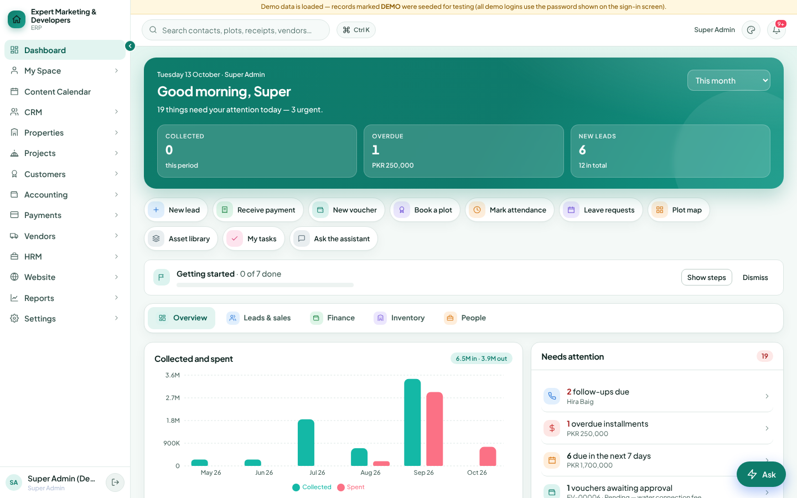
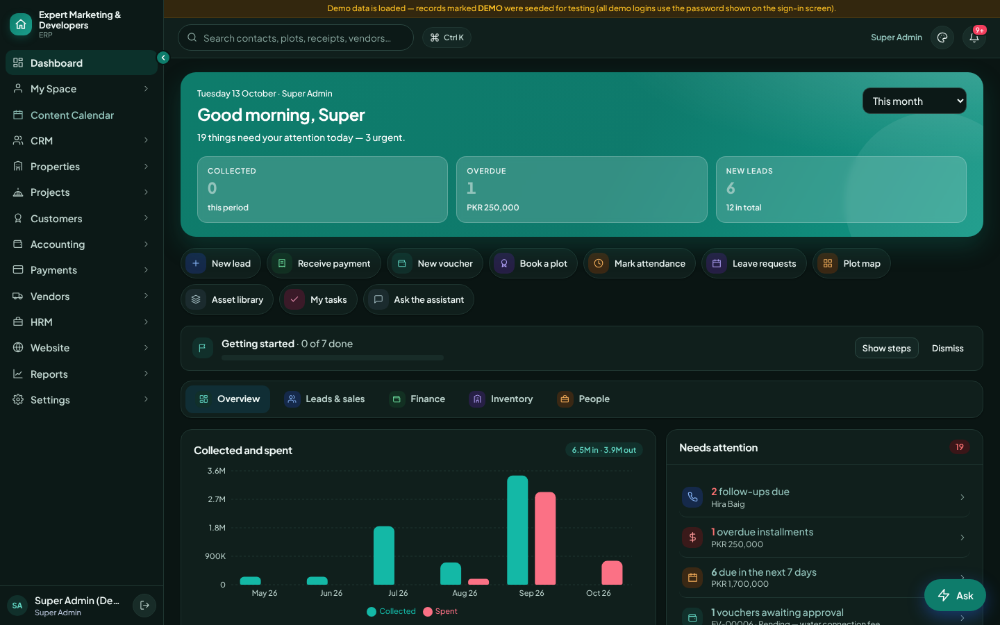
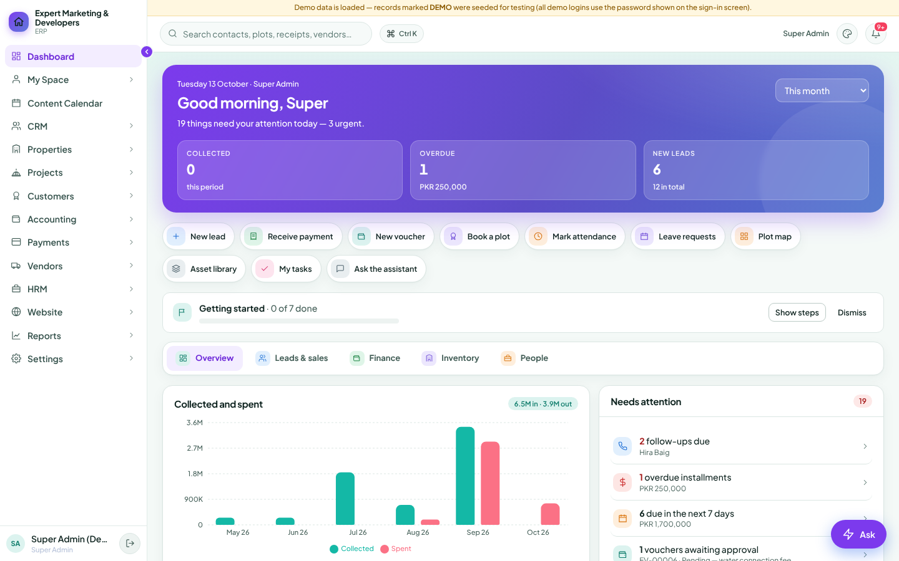
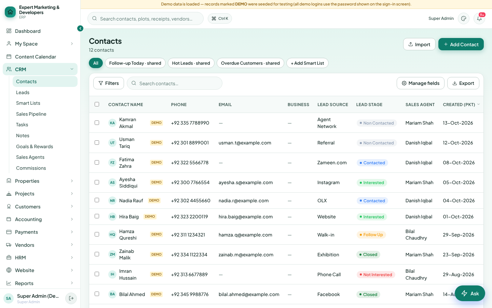
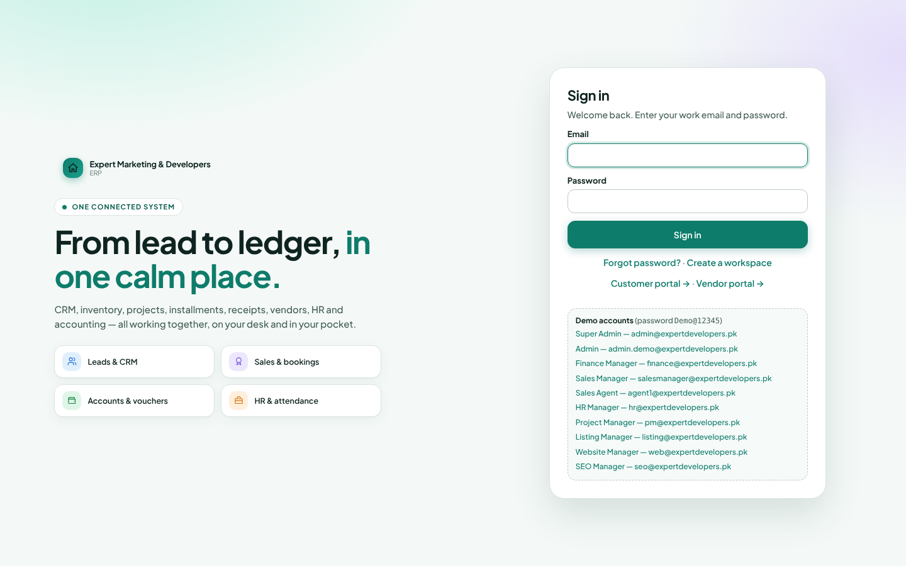

# 07 — Reference screens (rendered from the running reference app)

Captured with headless Chromium against Agentify ERP running on a throw-away database (demo data, Super Admin login), viewport 1440×900. Use them as the visual target when a new ERP is built; compare your screens side by side in light, dark and one non-default accent.

| Screenshot | What to look at |
|---|---|
|  | **Light / teal (default).** Mint page gradient, white sidebar with active pill, 22px-radius greeting hero with three translucent stat tiles, pastel quick-action pills (icon tile + label), dashboard tab strip, chart card + "Needs attention" list, floating "Ask" FAB, demo ribbon above the top bar |
|  | **Dark / teal.** Green-black surfaces, same hierarchy. ⚠ the hero stat numbers are dimmed here — a reference defect (see `02-color-system.md` §Known colour debts #5), do not copy |
|  | **Accent switch (violet).** Everything accent-derived follows `--primary*` — hero gradient, active nav pill, chips, FAB, selected tab. Hard-coded teal chart series remain teal (by design) |
|  | **Standard list page.** `PageHead` (title + count, Import / primary Add), smart-list chips, `Card flush` with toolbar (Filters, search pill, Manage fields, Export), `DataTable` with uppercase 12px headers, avatar-initial cells, DEMO chips, stage pills, nowrap dates. ⚠ stage pills "Non Contacted"/"Follow Up" are low contrast (§debt #6) |
|  | **Auth page (`auth2`).** Two radial colour blobs, eyebrow chip, large tracked headline with accent `<em>`, feature tiles, 24px-radius sign-in card |

## Measured values (computed styles from the running app, light/teal/comfortable)

| Element | Measured |
|---|---|
| `body` | Plus Jakarta Sans first in stack · **14px / 500 / lh 1.45 (20.3px)** · `rgb(15,36,32)` on `rgb(244,249,247)` |
| Greeting H2 (`.hero h2`) | 24px / 700 / letter-spacing −0.48px (= −.02em) |
| `.hero` radius | 22px |
| `.card` | radius 16px · border `rgb(219,230,227)` (#dbe6e3) · shadow `0 1px 2px rgba(18,64,54,.04), 0 6px 20px rgba(18,64,54,.05)` |
| `.sidebar` | 236px wide, white; nav item 14px, active weight 700, radius 10px |
| `.topbar` | 58px |
| Table header | 12px / 700 / uppercase / letter-spacing .48px (= .04em) |
| Table cell | 13.5px, padding 9px 12px |
| CSS variables on `<html>` | `--primary #0e7c6b`, `--primary-d #0b5f52`, `--primary-l #e2f4f0`, `--bg #f4f9f7`, `--text #0f2420`, `--muted #435e57`, `--faint #5d7a73`, `--radius 16px`, `--border #dbe6e3` — identical to `tokens/design-tokens.css` (`tools/check-token-drift.mjs` verifies the static cascade; this table verifies the runtime result) |

To refresh the screenshots after the reference changes: start the app on a temp data dir (`ERP_DATA_DIR`, `ERP_UPLOAD_DIR`, `ERP_DB` pointing at a scratch folder, `PORT=4123`), sign in as `admin@expertdevelopers.pk` / `Demo@12345`, and capture with Playwright using `localStorage['erp-appearance'] = {"theme":"dark","accent":"violet"}` set before load.
